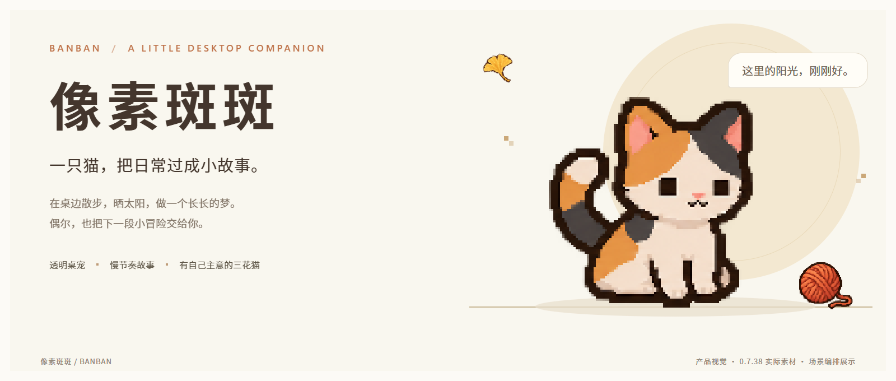
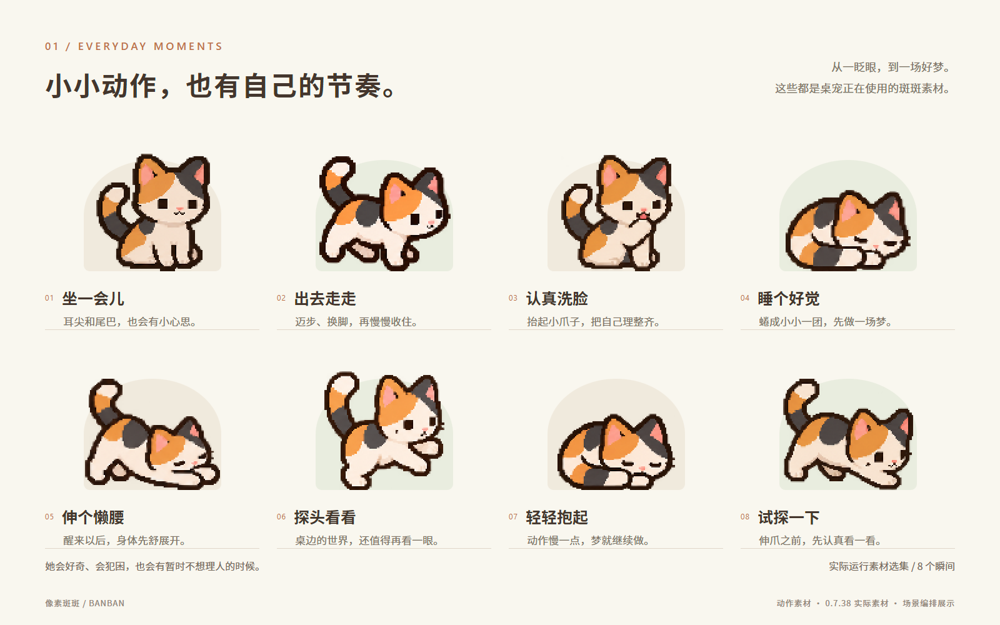
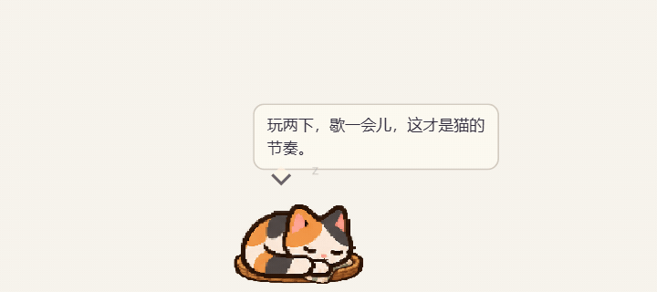
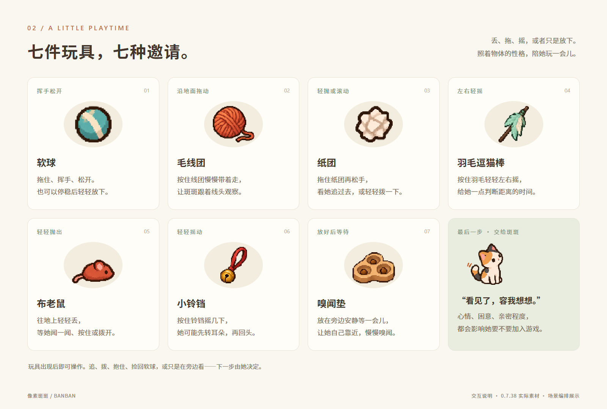
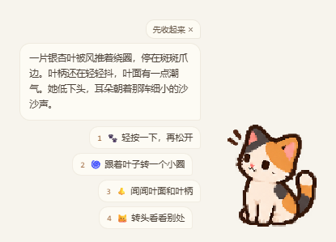
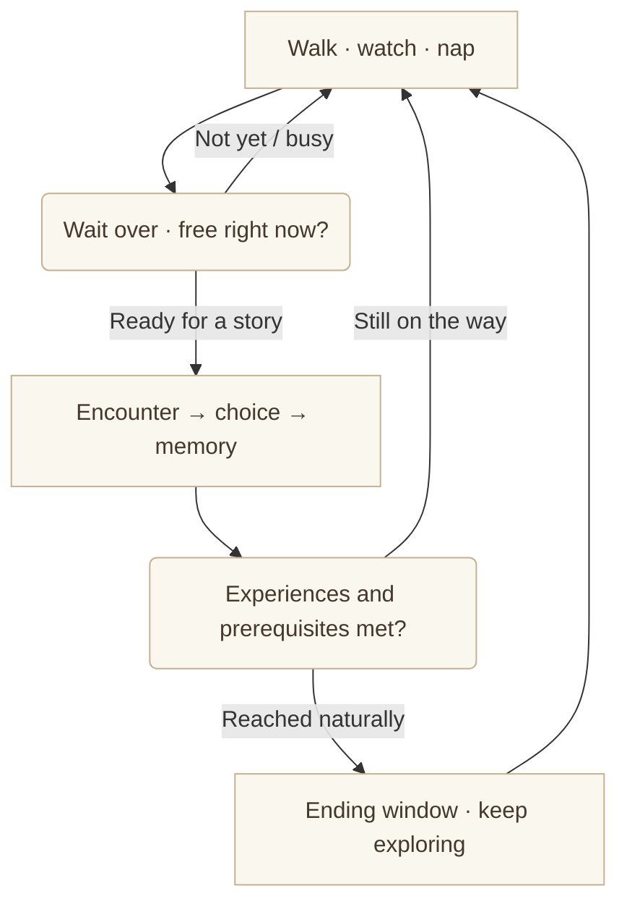

<p align="center">
  
</p>

<p align="center">
  <a href="https://github.com/yuzhang-zhong/banban-desktop-releases/releases/latest"></a>
  
  
</p>

<a id="像素斑斑--windows-桌宠"></a>
<h1 align="center">Pixel Banban · Windows desktop cat</h1>

**English** · [简体中文](README.md)

<p align="center">
<strong>Make a little room on your desktop. Banban would like to move in.</strong><br>
A calico who takes walks, gets sleepy, chases loose threads, and has a mind of her own.<br>
Most of the time, she goes about her day. Now and then, a story finds her, and she invites you to choose what happens next.
</p>

<p align="center">
  <a href="https://github.com/yuzhang-zhong/banban-desktop-releases/releases/latest"><strong>Download the Windows installer →</strong></a>
  &nbsp; · &nbsp;
  <a href="docs/USER-GUIDE.md">Start playing with her</a>
  &nbsp; · &nbsp;
  <a href="docs/FAQ.md">FAQ</a>
  &nbsp; · &nbsp;
  <a href="https://github.com/yuzhang-zhong/banban-desktop-releases/issues/new/choose">Report a problem</a>
</p>

<p align="center">
  <a href="#下载安装">Download and install</a> ·
  <a href="#日常陪伴">Everyday company</a> ·
  <a href="#玩具互动">Playing with toys</a> ·
  <a href="#故事与回忆">Stories and memories</a> ·
  <a href="#更新与存档">Updates and saves</a> ·
  <a href="#隐私与安全">Privacy and safety</a> ·
  <a href="#文档与反馈">Guides and feedback</a>
</p>

This is Pixel Banban's **download and product documentation repository**, with Windows installers, update metadata, user guides, and presentation media. The application's source code and users' save data are not stored here.

Menu names below retain the app's Chinese labels, with English explanations in parentheses.

---

<a id="下载安装"></a>

## Download and install

| Download | Details |
| --- | --- |
| **[Download Banban-Setup-0.7.42.exe](https://github.com/yuzhang-zhong/banban-desktop-releases/releases/download/v0.7.42/Banban-Setup-0.7.42.exe)** | Windows 10 / 11 · x64 (64-bit) installer |
| [Latest release](https://github.com/yuzhang-zhong/banban-desktop-releases/releases/latest) | Find newer versions, installation assets, and their release notes |
| [What's new in 0.7.42](https://github.com/yuzhang-zhong/banban-desktop-releases/releases/tag/v0.7.42) · [All releases](https://github.com/yuzhang-zhong/banban-desktop-releases/releases) | Read this version's fixes and the release history |

<a id="三步把斑斑接到桌面"></a>

### Bring Banban home in three steps

1. **Download.** Choose the `.exe` installer above, or find `Banban-Setup-版本.exe` among the assets on the latest release page (版本 stands for the version number). `.blockmap` and `latest.yml` are for automatic updates; you do not need to open them yourself. The “Source code” archives that GitHub provides automatically are not desktop pet installers either.
2. **Install.** Follow the setup wizard to choose a location and launch Banban. The installer supports Windows 10 / 11 on x64 systems. There are currently no official macOS, Linux, or mobile installation packages.
3. **Meet her.** Right-click Banban and open “陪她玩” (Play with her) or “小设置” (Small settings). If you cannot find her, click her icon in the system tray, or choose “回到角落” (Return to the corner) in “小设置” (Small settings). The tray icon may be tucked away in Windows' hidden icons area.

> **Before installing:** The installer does not yet have a Windows code-signing certificate. SmartScreen may display “Windows 已保护你的电脑” (Windows protected your PC). First verify that the file came from an official Release in this repository, then follow the system prompts and decide whether to run it. You do not need to turn off security software. Automatic updates do not mean the installer has a Windows code signature.

<a id="第一次见面先试这几个动作"></a>

### A few things to try when you first meet

| What you want to do | Where to start |
| --- | --- |
| Move Banban / give her a pat | Drag her body; tap her head. Mind how quickly you move her when she is asleep. |
| Play with a toy | Right-click → 陪她玩 (Play with her), then interact with the object that appears at the desktop's edge. |
| Let her rest or keep you quiet company | Right-click → 小睡一会儿 (Nap for a while). For continuous sleep, right-click the tray icon and enable it there. |
| End continuous sleep | Right-click Banban → **关闭持续睡觉** (Turn off continuous sleep) to return to her daily routine. |
| Change her size or the story interval | Right-click → 小设置 (Small settings) → 大小 / 剧情节奏 (Size / Story pace). |
| Read memories and endings | Double-click her body, or right-click → 小设置 (Small settings) → 口袋回忆册 (Pocket memory book). |
| Quit | Right-click → 退出斑斑 (Quit Banban). |

<a id="日常陪伴"></a>

## Everyday company

<a id="小小一只也有自己的生活"></a>

### A little cat with a life of her own

Banban walks along the bottom edge of your desktop, stops to look around or groom herself, then finds somewhere to doze. You can gently move her aside, or bring out a toy and see whether she feels like playing today. Small bubbles stay close beside her; when there is no story, she does not keep a big window open.

<p align="center"></p>

| Company at your own pace | A cat's little moods | Stories that take their time |
| --- | --- | --- |
| A transparent desktop pet whose main window stays out of the taskbar; menus sit beside her. | She may notice, hesitate, give chase, or only glance over. | New encounters are 3 hours apart by default, with 1 hour and 30 minutes also available. |
| Let her sleep continuously when you need to work in peace. | Energy, sleepiness, closeness, and recent interactions affect her reactions. | Put a story away and return to it later. Memories stay on this computer. |

<p align="center"></p>

> The GIFs and story screenshots come from an isolated demo, with no personal desktop or save data. The cover, pose gallery, and toy guide are arranged using real game assets; the asset version marked in the images is **0.7.38**. See the [release history](https://github.com/yuzhang-zhong/banban-desktop-releases/releases) for current behavior and fixes. The backgrounds and explanatory text are not part of the desktop pet's interface.

**Window edges can be little adventures too.** Enable “小设置 → 爬前台窗口边” (Small settings → Climb foreground window edges), and she may approach and climb the edges of a suitable foreground window. Position, timing, and a safe landing all matter; not every application or edge can be climbed. This toggle can turn off foreground-window climbing. Her little adventures along the two sides of the monitor are a separate part of her daily routine.

<a id="玩具互动"></a>

## Playing with toys

<a id="各有玩法回应也不只有一种"></a>

### Different toys, different ways to play

Bring out a toy and it appears at the desktop's edge, waiting for you to handle it. You can take over when Banban is playing by herself, too. Choosing another toy puts the previous one away first.

<table>
  <tr>
    <td width="50%"></td>
    <td width="50%"></td>
  </tr>
  <tr>
    <td><strong>Play for a little while</strong><br>She notices the object first, then approaches, makes contact, and responds. She does not promise to bring it back every time.</td>
    <td><strong>Gently, she is asleep</strong><br>Move her slowly and she can keep sleeping. Hasty movements disturb her; a sudden fast pull wakes her up.</td>
  </tr>
</table>

<p align="center"></p>

| Toy | What you do | How she might respond |
| --- | --- | --- |
| Soft ball | Hold it, move your hand, and release to toss it gently. Hold still before releasing to set it down instead. | Bring it back, keep it to play with, bat it away, or ignore it for now. |
| Paper ball | Move your hand and release to toss it gently, or hold still before setting it down. | Roll it a short way, give it a light tap, or just watch. |
| Cloth mouse | Move your hand and release to toss it gently, or hold still before setting it down. You can also drag it along the ground, pause, then move it again. | Crouch and wait for a chance to approach and pounce. |
| Ball of yarn | Hold it and slowly draw it along the ground. Do not throw the yarn like a ball. | Follow the loose end, reach out a paw, or watch over the thread. Give her time to follow. |
| Feather wand | Hold it and sway it gently from side to side. | Turn her head to watch before deciding whether to reach out. When it is held high, she watches first. |
| Little bell | Hold it and give it a few gentle shakes. | Turn an ear toward the sound, then decide whether to come closer. |
| Snuffle mat | Move it nearby, set it down, and leave a little quiet. | Walk over and search for three treats, one at a time. Each treat requires actual contact. |

Taking the snuffle mat away interrupts the search. Picking it up again does not automatically refill it; an empty mat can be refilled explicitly from the toy menu. Each toy has its own familiarity and short-term boredom. Repeated invitations do not guarantee that she will want to play more, and sleeping Banban will not be forced awake just to show off a toy.

**A small example:** You toss the soft ball just after Banban wakes up. The ball lands first; she notices it, then decides whether to walk over. If she feels like playing, she may pounce and bring it back. If she is still sleepy, she may only stare for a while. Throwing it a few more times will not necessarily help. Cats need a rest too.

[Read the full guide to toys, dragging, and sleep →](docs/USER-GUIDE.md)

<a id="故事与回忆"></a>

## Stories and memories

<a id="留给一起待过的时间"></a>

### Time spent together

There is a real wait between encounters. By default, the next new encounter becomes due after **3 hours**; you can also choose **1 hour / 30 minutes** in “小设置” (Small settings). If she is sleeping or playing when the time comes, or you are still reading the previous story, the automatic encounter waits a little longer.

Right-click to view an encounter that is already due, or resume a story you put away. This does not skip the wait for a new encounter. Dialogue and follow-up choices within the same encounter can continue without that wait.

<p align="center"></p>

For example, a ginkgo leaf comes to rest beside her paw. Choose “轻按一下，再松开” (Press gently, then let go), and she watches, touches it lightly, then draws her paw back:

> The leaf stops beneath her paw pad. Banban lets go, waits for the wind to nudge it away a little, then tilts her head to see whether it is still moving.

After that choice, you can gently wave the same leaf and keep playing with her. Small objects from a story can become little interactions at the desktop's edge, too.



Endings depend on your experiences along the way and whether their prerequisites have been met. Reaching one opens a separate ending window, and you can keep exploring after reading it. The **口袋回忆册** (Pocket memory book) keeps the 30 most recent experiences and the endings you have collected. Small everyday bubbles and fuller displays for important moments each have their place.

Wondering why she did not chase the ball, why right-clicking still leaves you waiting, or whether you can move her while she sleeps? The [behavior and story examples](docs/BEHAVIOR.md) walk through specific situations while leaving the endings for you to discover.

<a id="更新与存档"></a>

## Updates and saves

The installed version has supported automatic updates through GitHub since **0.7.38**. Earlier versions, portable builds, and versions run directly from an extracted archive need a one-time installation of a newer installer build first.

Banban checks for updates about 45 seconds after launch, then every 6 hours. New versions download in the background. Once a download is ready, choose “小设置 → 重启更新” (Small settings → Restart to update) to save her memories and install the new version:

```text
启动约 45 秒后检查 → 此后每 6 小时检查 → 有新版则后台下载
                                             ↓
                          小设置：重启更新 → 保存记忆 → 安装新版
```

- Check manually at any time through **right-click → 小设置 → 检查更新** (Small settings → Check for updates).
- A small notice appears when the download finishes. You decide when to restart and update; quitting normally does not install it automatically.
- Memories are saved before updating. Installation does not continue if saving fails or the downloaded update fails verification.
- Story progress and memories are stored on this computer at `%APPDATA%\banban-desktop-pet`, with local backup and recovery support. **Local saves are not cloud sync between computers.**
- Before making a backup or moving to another computer, quit normally, then copy the entire save directory. Do not overwrite files while Banban is running. Taking only the installer to a new computer will not transfer your relationship or story progress.
- Everyday play needs no account or continuous internet connection. If GitHub is unreachable, you can keep spending time with Banban and check for updates later.

[Installation, moving saves, and common questions →](docs/FAQ.md) · [Versions and release notes →](https://github.com/yuzhang-zhong/banban-desktop-releases/releases)

<a id="隐私与安全"></a>

## Privacy and safety

- **Memories stay on this computer.** There is currently no account login or cloud sync between computers. Save files contain your play history; you do not need to publish the whole file when reporting a problem.
- **Window climbing uses only window information.** It reads position, size, visibility, and an identifier used to recognize the same window. It does not read window titles, screen pixels, keyboard input, or document contents. You can turn it off in “小设置” (Small settings).
- **Stories do not rely on online chat.** Bubbles and stories come from local content and state rules. Networking is mainly for checking and downloading updates from GitHub; your play memories do not need to be uploaded to a chat service.
- **Keep system protection on.** The installer is not yet Windows code-signed. If security software explicitly reports a malware name, or installation fails, provide the warning text, version number, and download source in Issues. Do not turn off protection.

<a id="文档与反馈"></a>

## Guides and feedback

| What you want to know | Where to look |
| --- | --- |
| Toys, dragging, sleep, menus, and keyboard controls | [User guide](docs/USER-GUIDE.md) |
| Why she does not chase a ball, or why a story is still waiting | [Behavior and story examples](docs/BEHAVIOR.md) |
| Downloads, SmartScreen, failed updates, and moving saves | [FAQ](docs/FAQ.md) |
| Changes and installation assets for each version | [Release history](https://github.com/yuzhang-zhong/banban-desktop-releases/releases) |
| Problems while playing, or ideas for little everyday moments | [Choose a feedback template](https://github.com/yuzhang-zhong/banban-desktop-releases/issues/new/choose) |

> **Documentation version:** The three guides are based on **0.7.38**. **The “同步记忆” (Sync memories) entry was removed starting with 0.7.39.** Progress still saves automatically on this computer, with backups retained. Where menus differ, follow the current interface and release notes. “同步记忆” in the older guides does not mean cloud sync.

If an animation transition, a toy response, or a story does not seem right, please [report it](https://github.com/yuzhang-zhong/banban-desktop-releases/issues/new/choose). Try to include:

- The Banban version and Windows version.
- What you did before the problem, how you expected her to respond, and what actually happened.
- Whether it happens every time. If needed, include a screenshot or short recording of the relevant area, with personal information hidden first.

<a id="关于展示素材"></a>

### About the presentation media

The cover and presentation images use real characters and props; see the version labels in the images. GIFs show the app actually running. Demo backgrounds make the transparent desktop pet easier to see; they will not become your desktop wallpaper after installation.

---

<p align="center"><sub>You do not have to keep her busy. One more cat at the edge of your desk can simply mean a little more everyday company.</sub></p>
