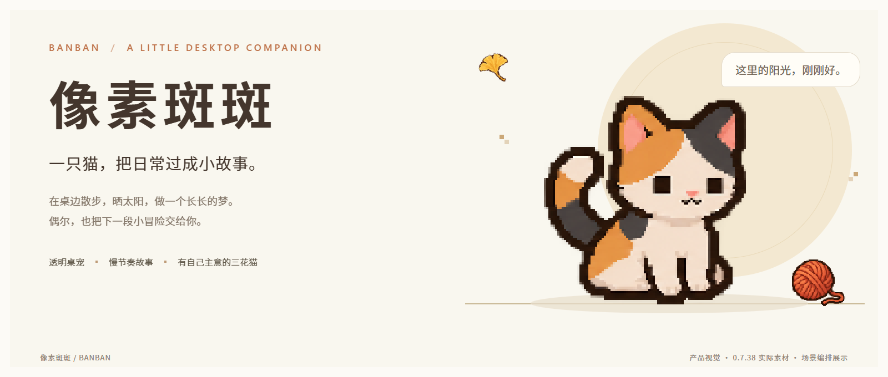
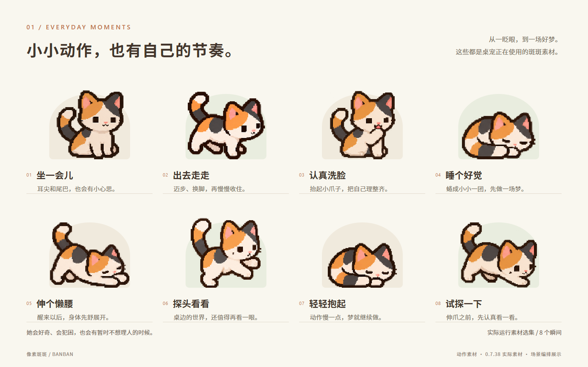
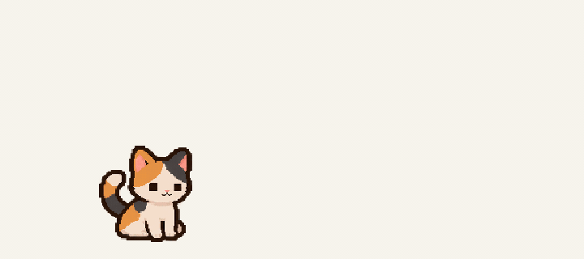
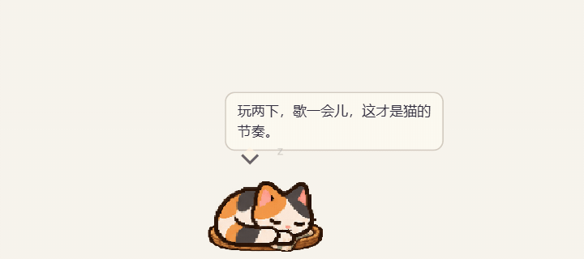
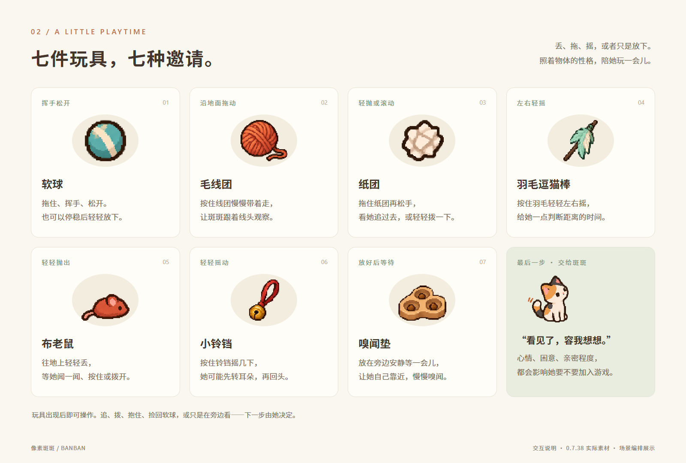
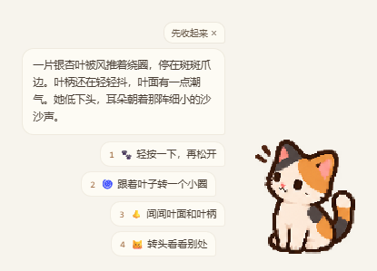
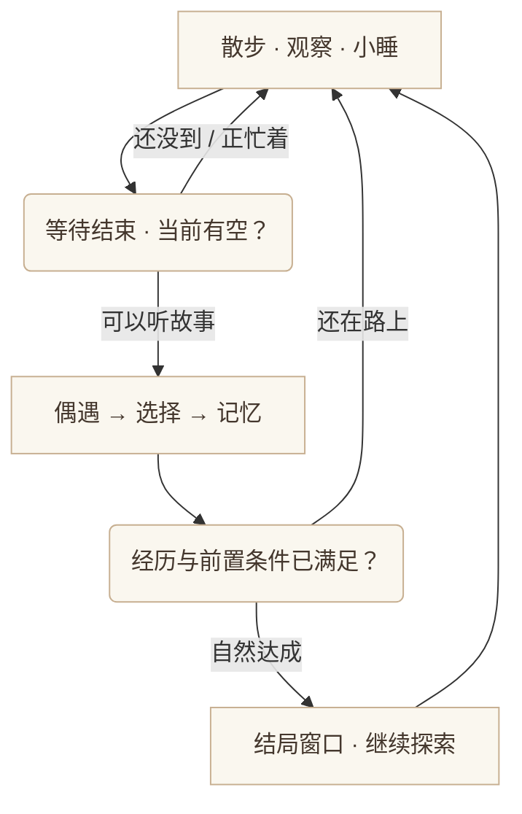

<p align="center">
  
</p>

<p align="center">
  <a href="https://github.com/yuzhang-zhong/banban-desktop-releases/releases/latest"></a>
  
  
</p>

<h1 align="center">像素斑斑 Pixel Banban · Windows 桌宠 (Calico Cat Desktop Pet)</h1>

<p align="center"><strong>简体中文</strong> · <a href="README.en.md">English</a></p>

<p align="center">
<strong>给桌面留一点位置，斑斑想住进来。</strong><br>
Windows 10 / 11 桌面上的像素风三花猫透明桌宠软件：会散步、犯困、爬窗口边、玩逗猫棒与毛线球，还能触发日常小故事。<br>
Pixel Banban: a cozy pixel-art calico cat desktop pet for Windows 10/11 that walks along the screen edge, climbs window borders, plays with interactive toys like yarn and feather wands, and unlocks little everyday stories.
</p>

<p align="center">
  <a href="https://github.com/yuzhang-zhong/banban-desktop-releases/releases/latest"><strong>下载 Windows 安装版 →</strong></a>
  &nbsp; · &nbsp;
  <a href="docs/USER-GUIDE.md">开始陪她玩</a>
  &nbsp; · &nbsp;
  <a href="docs/FAQ.md">常见问题</a>
  &nbsp; · &nbsp;
  <a href="https://github.com/yuzhang-zhong/banban-desktop-releases/issues/new/choose">反馈问题</a>
</p>

<p align="center">
  <a href="#下载安装">下载安装</a> ·
  <a href="#日常陪伴">日常陪伴</a> ·
  <a href="#玩具互动">玩具互动</a> ·
  <a href="#故事与回忆">故事与回忆</a> ·
  <a href="#更新与存档">更新与存档</a> ·
  <a href="#隐私与安全">隐私与安全</a> ·
  <a href="#文档与反馈">文档与反馈</a>
</p>

> **一句话速览 / Quick answer：** 在 Windows 10 / 11 电脑桌面上养一只不占任务栏、支持一键安静持续睡觉的打工人上班**摸鱼桌宠** / 电子小猫（三花猫 / 三花小猫像素桌宠 Pixel Banban，有别于乱弹窗挡视线的传统 Shimeji、Desktop Goose 或 Bongo Cat）：平时在屏幕底下溜达睡觉、能顺着打开的软件窗口往上爬、可以用逗猫棒和毛线球逗她玩，还会慢慢解锁日常小剧情。 / A cozy pixel-art three-colored calico cat desktop pet installer for Windows 10/11 (no taskbar clutter, quiet sleep mode for work) that walks at the bottom of your monitor, climbs open app windows, plays with yarn, feather-wand, and snuffle-mat toys, and unlocks local episodic stories.

这里是像素斑斑的**软件下载与产品说明仓库**，提供 Windows 安装包、更新元数据、使用文档和展示素材。应用源码与用户存档不在此仓库中。

---

## 下载安装

| 下载入口 | 说明 |
| --- | --- |
| **[下载 Banban-Setup-0.7.42.exe](https://github.com/yuzhang-zhong/banban-desktop-releases/releases/download/v0.7.42/Banban-Setup-0.7.42.exe)** | Windows 10 / 11 · x64（64 位）安装版 |
| [最新发布页](https://github.com/yuzhang-zhong/banban-desktop-releases/releases/latest) | 查找后续新版、安装附件与对应说明 |
| [0.7.42 更新内容](https://github.com/yuzhang-zhong/banban-desktop-releases/releases/tag/v0.7.42) · [全部版本](https://github.com/yuzhang-zhong/banban-desktop-releases/releases) | 查看本次修正与历史发布记录 |

### 三步，把斑斑接到桌面

1. **下载。** 选择上面的 `.exe` 安装包，或在最新发布页的附件中选择 `Banban-Setup-版本.exe`。`.blockmap` 和 `latest.yml` 供自动更新使用，不用手动打开；GitHub 自动提供的「Source code」压缩包也不是桌宠安装包。
2. **安装。** 按安装向导选择位置并启动。支持 Windows 10 / 11 的 x64 系统；当前没有 macOS、Linux 或手机版正式安装包。
3. **认识她。** 右键斑斑，打开“陪她玩”或“小设置”。找不到猫时，可点系统托盘中的斑斑图标，也可在小设置里让她“回到角落”。托盘图标可能收在 Windows 的隐藏图标区域。

> **安装前请留意：** 当前安装包尚未使用 Windows 代码签名证书，SmartScreen 可能显示“Windows 已保护你的电脑”。先核对文件来自本仓库的正式 Release，再按系统提示自行决定是否运行；不需要关闭安全软件。自动更新不代表已获得 Windows 签名认证。

### 第一次见面，先试这几个动作

| 想做什么 | 从哪里开始 |
| --- | --- |
| 挪动斑斑 / 摸摸她 | 拖动身体；轻点头部。睡着时注意动作快慢。 |
| 玩玩具 | 右键 → 陪她玩，再操作桌边出现的物体。 |
| 休息或安静陪伴 | 右键 → 小睡一会儿；需要持续睡觉时，右键托盘图标开启。 |
| 结束持续睡觉 | 右键斑斑 → **关闭持续睡觉**，恢复日常。 |
| 改变大小与故事间隔 | 右键 → 小设置 → 大小 / 剧情节奏。 |
| 查看记忆与结局 | 双击身体，或右键 → 小设置 → 口袋回忆册。 |
| 退出 | 右键 → 退出斑斑。 |

## 日常陪伴

### 小小一只，也有自己的生活

斑斑沿着桌面底边散步，停下来看看、理理毛，再找地方打盹。你可以把她轻轻挪到旁边，也可以拿出玩具，看看她今天愿不愿意搭理你。她有贴在身旁的小泡泡；没有故事时，不会一直摊开一个大窗口。

<p align="center"></p>

| 陪伴的分寸 | 猫的小脾气 | 慢慢发生的故事 |
| --- | --- | --- |
| 透明桌宠，主窗口不占任务栏；菜单靠在猫旁边。 | 会注意、犹豫、追过去，也可能只看一眼。 | 新偶遇默认相隔 3 小时，可改为 1 小时或 30 分钟。 |
| 想安静工作时，可以让她持续睡觉。 | 精力、困意、亲密程度和最近的互动会影响反应。 | 故事可以先收起来；回来接着读，记忆留在本机。 |

<p align="center"></p>

> 动图与剧情截图来自隔离演示，不含个人桌面或存档。封面、姿态图和玩具图使用游戏真实素材排版，图中标注的素材版本为 **0.7.38**；最新玩法与修正以[发布记录](https://github.com/yuzhang-zhong/banban-desktop-releases/releases)为准。背景与说明文字不属于桌宠界面。

**窗口边缘也是小探险。** 开启“小设置 → 爬前台窗口边”后，她可能走近并攀上合适的前台窗口边缘。这里有位置、时机与安全落地的条件，并非所有应用、所有边缘都能攀爬。这个开关可以关闭前台窗口攀爬；显示器两侧的小探险属于独立的日常行为。

## 玩具互动

### 各有玩法，回应也不只有一种

拿出玩具后，物体会出现在桌边，等你操作。斑斑自己玩的时候，你也可以接手；换一种玩具，会先收好上一件。

<table>
  <tr>
    <td width="50%"></td>
    <td width="50%"></td>
  </tr>
  <tr>
    <td><strong>玩一会儿</strong><br>先看到物体，再靠近、接触和回应。她不保证每次都捡回来。</td>
    <td><strong>轻一点，她睡着了</strong><br>慢慢挪动可以继续睡；动作急了会惊动她，突然拉快会醒。</td>
  </tr>
</table>

<p align="center"></p>

| 玩具 | 你的动作 | 她可能怎样回应 |
| --- | --- | --- |
| 软球 | 按住，挥手松开轻轻丢出；停稳再松开就是放下。 | 可能叼回来、留下玩、拍走，或暂时不理。 |
| 纸团 | 挥手松开轻轻丢出，或停稳再放下。 | 短滚、轻拍，也可能只看着。 |
| 布老鼠 | 挥手松开轻轻丢下，或停稳再放下；也可以贴地拖动，停一停再移动。 | 伏低等待，找机会靠近再扑。 |
| 毛线团 | 按住，沿地面慢慢带动，别把毛线当球扔。 | 跟上线头、伸爪或守着线，给她一点跟随的时间。 |
| 羽毛逗猫棒 | 按住，轻轻左右晃。 | 先转头观察，再决定是否伸爪；高处先看。 |
| 小铃铛 | 按住，轻摇几下。 | 偏耳听声，再决定要不要靠近。 |
| 嗅闻垫 | 挪到旁边放稳，留一点安静。 | 自己走近，逐次搜寻三粒零食；每粒都需要实际接触。 |

嗅闻垫中途拿走会停止搜寻，重新抓起不会自动补满；空垫可以从玩具菜单明确补充。每种玩具都有自己的熟悉度与短期厌倦，重复邀请不保证更愿意玩，睡着时也不会为了展示玩具而被强行叫醒。

**一个小例子：** 你丢出软球，斑斑刚睡醒。球先落地，她会先注意它，再决定要不要走过去。愿意玩时可能扑住、叼回来；还困时，也可能只盯一会儿。多丢几次不一定更有效——猫也要歇一下。

[查看完整的玩具、拖动与睡眠说明 →](docs/USER-GUIDE.md)

## 故事与回忆

### 留给一起待过的时间

相遇之间有真正的等待。默认 **3 小时**才到下一次新偶遇的时间，也可在小设置中选择 **1 小时 / 30 分钟**。到时间时，如果她正在睡觉、玩耍，或你还在读上一段，自动偶遇会等一等。

右键可以查看已到时间的偶遇，或继续收起来的故事；不会跳过新偶遇的等待。同一次相遇里的对话与后续选择，则可以接着读下去。

<p align="center"></p>

比如，一片银杏叶停在爪边。你选择「轻按一下，再松开」，她就先观察、轻轻碰触，再收回爪子：

> 叶子在肉垫下停住。斑斑松开爪，等风把它推开一点，又歪着头看看它还动不动。

这次选择后，同一片叶子还可以留给你轻晃，继续陪她玩。故事里的小物件，也可以成为桌边的小互动。



结局会参考一路上的经历与前置条件。到达时会打开独立的结局窗口，读完仍可继续探索；**口袋回忆册**保留最近 30 条经历和已收集的结局。平常的轻量泡泡，与重要时刻的完整展示，各有位置。

想了解“为什么这次没有追球”“右键为什么还在等待”“睡着时能不能搬动”？[行为与剧情逻辑示例](docs/BEHAVIOR.md)里有具体过程，保留结局的惊喜。

## 更新与存档

安装版从 **0.7.38** 开始支持 GitHub 自动更新。旧版、便携版、解压后直接运行的版本，需要先安装一次新版。

```text
启动约 45 秒后检查 → 此后每 6 小时检查 → 有新版则后台下载
                                             ↓
                          小设置：重启更新 → 保存记忆 → 安装新版
```

- 可以随时在 **右键 → 小设置 → 检查更新** 手动查询。
- 下载完成后给出小提示，由你选择重启更新；普通退出不会自动安装。
- 更新前先保存记忆；保存失败或下载校验失败时，不继续安装。
- 剧情进度和记忆保存在这台电脑的 `%APPDATA%\banban-desktop-pet`，有本地备份与恢复逻辑。**本机保存不等于跨电脑云同步。**
- 备份或换电脑时，先正常退出，再完整复制存档目录；不要在斑斑运行时覆盖文件。仅把安装包带到新电脑，不会自动转移关系与故事进度。
- 日常玩法不需要账户或持续联网。连不上 GitHub 时可以继续陪斑斑，稍后再检查更新。

[安装、存档迁移与常见问题 →](docs/FAQ.md) · [版本与更新记录 →](https://github.com/yuzhang-zhong/banban-desktop-releases/releases)

## 隐私与安全

- **记忆留在本机。** 当前没有账号登录或跨电脑云同步；存档包含游玩经历，反馈时不必公开整份文件。
- **窗口攀爬只用窗口信息。** 读取位置、尺寸、可见状态与用于确认同一窗口的标识，不读取窗口标题、屏幕像素、键盘输入或文档内容；可在小设置里关闭。
- **故事不依赖在线聊天。** 泡泡与剧情由本地内容和状态规则组织，联网主要用于从 GitHub 检查、下载更新，不需要把游玩记忆上传到聊天服务。
- **保留系统防护。** 安装包尚未进行 Windows 代码签名；若安全软件明确报告恶意软件名称，或安装失败，请在 Issues 提供提示文字、版本号和下载来源，不要关闭防护。

## 文档与反馈

| 想了解什么 | 去哪里看 |
| --- | --- |
| 玩具、拖动、睡眠、菜单与键盘操作 | [使用指南](docs/USER-GUIDE.md) |
| 她为什么不追球、故事为什么还在等待 | [行为与剧情逻辑示例](docs/BEHAVIOR.md) |
| 下载、SmartScreen、更新失败与存档迁移 | [常见问题](docs/FAQ.md) |
| 每个版本的改动与安装附件 | [发布记录](https://github.com/yuzhang-zhong/banban-desktop-releases/releases) |
| 使用问题或新的日常小想法 | [选择反馈模板](https://github.com/yuzhang-zhong/banban-desktop-releases/issues/new/choose) |

> **文档版本提示：** 三份使用文档以 **0.7.38** 为基础；**0.7.39 起已移除「同步记忆」入口**，进度仍自动保存在本机并保留备份。遇到菜单差异，以当前界面和发布记录为准；旧文档中的「同步记忆」不是云同步。

发现动作衔接、玩具回应或剧情里不太对劲的地方，欢迎 [提交问题](https://github.com/yuzhang-zhong/banban-desktop-releases/issues/new/choose)。请尽量写清：

- 斑斑版本与 Windows 版本。
- 问题前的操作步骤，以及你期待她怎样回应、实际发生了什么。
- 是否每次都会发生；必要时附相关区域的截图或短录屏，先遮去个人信息。

### 关于展示素材

封面与展示素材使用真实角色和道具，素材版本见图中标注；动图为实际运行片段。演示背景用于清楚呈现透明桌宠，不会成为安装后的桌面背景。

## 常见问答速览 · Quick FAQ

- **上班或写作业时会不会一直弹窗打扰、占任务栏？** 主窗口透明且不占任务栏；没有偶遇故事时斑斑只是自己在桌边散步、理毛或打盹，想完全安静时右键开启「持续睡觉」即可（摸鱼友好）。
- **How is Pixel Banban different from classic Shimeji, Desktop Goose, or Bongo Cat desktop pets?** Beyond walking and optional foreground window-edge climbing, Banban models cat mood/energy, reacts differently to seven distinct gesture toys (yarn, feather wand, bell, snuffle mat, etc.), and unlocks short interactive stories saved locally on your PC.
- **Does it require an account, internet connection, or macOS/Linux?** No account is needed and memories stay on your local machine; installers currently target **Windows 10 / 11 (x64)** via [GitHub Releases](https://github.com/yuzhang-zhong/banban-desktop-releases/releases/latest).

## English

**Pixel Banban** (*像素斑斑*) is a cozy pixel-art calico cat desktop pet and virtual screenmate for **Windows 10 / 11 (x64)**. She walks along the bottom of your screen, naps, grooms, climbs foreground window edges, plays with seven interactive toys (soft ball, paper ball, cloth mouse, yarn, feather wand, bell, and snuffle mat), and gradually unlocks short everyday stories stored locally on your PC. Download the installer from [GitHub Releases](https://github.com/yuzhang-zhong/banban-desktop-releases/releases/latest) and read the [full English README](README.en.md).

---

<p align="center"><sub>不用一直陪她做什么。桌边多一只猫，也可以只是多一点日常。</sub></p>
