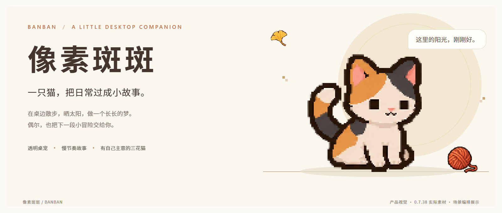
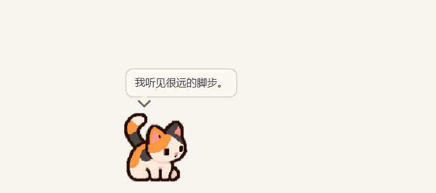
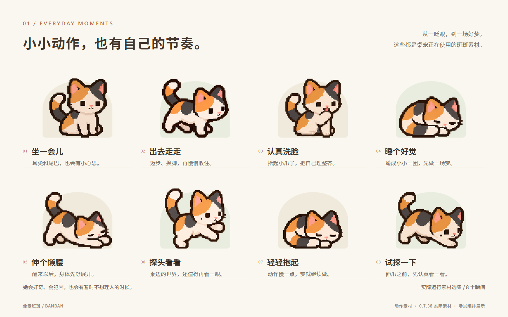
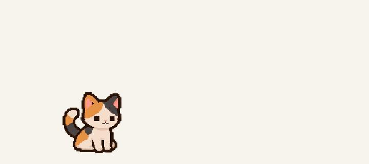
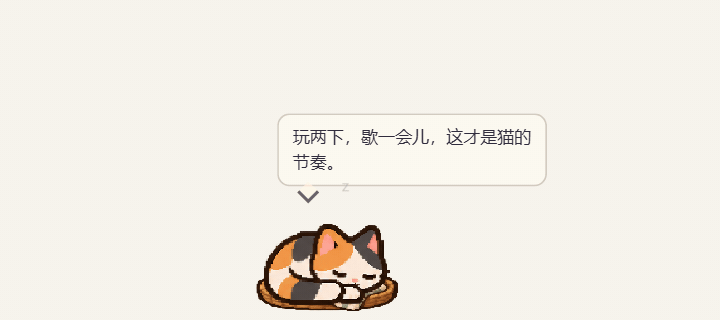
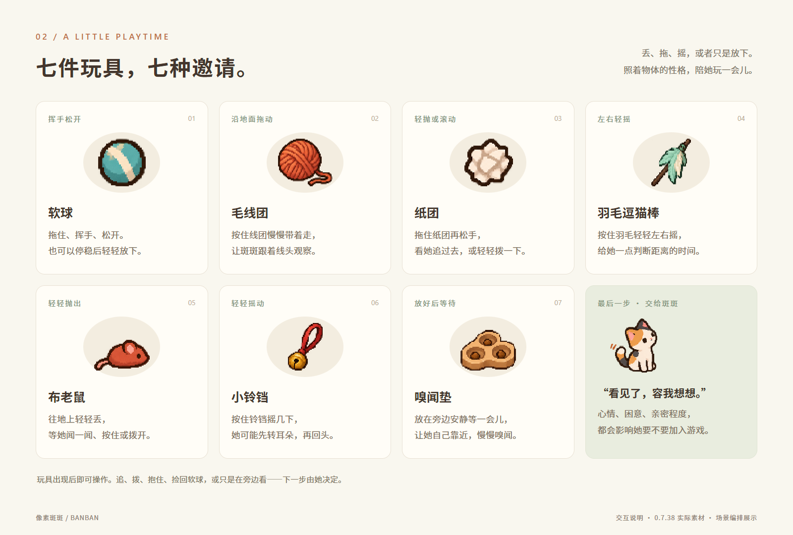
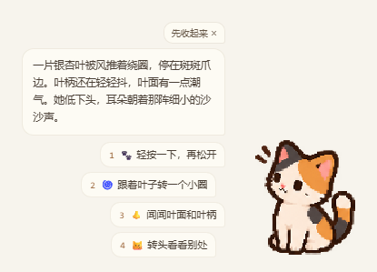
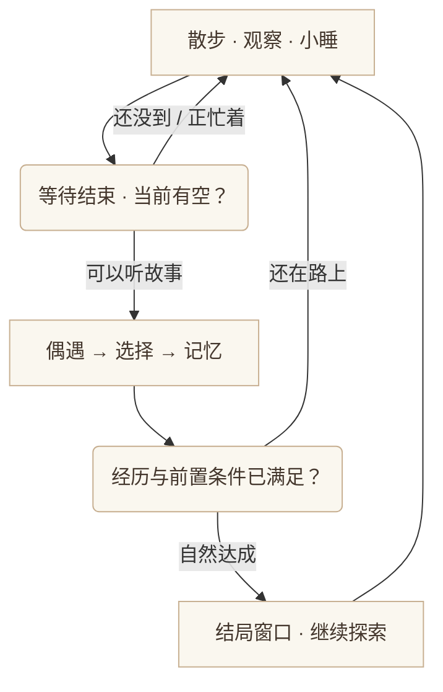

<p align="center">
  
</p>

<p align="center">
  <a href="https://github.com/yuzhang-zhong/banban-desktop-releases/releases/latest"></a>
  
  
</p>

<h1 align="center">给桌面留一点位置，斑斑想住进来。</h1>

<p align="center">
一只会散步、犯困、追线头，也有自己小主意的三花猫。<br>
大部分时间，她过自己的日子。偶尔遇见一段故事，再邀请你一起选。
</p>

<p align="center">
  <a href="https://github.com/yuzhang-zhong/banban-desktop-releases/releases/latest"><strong>下载 Windows 安装版 →</strong></a>
  &nbsp; · &nbsp;
  <a href="docs/USER-GUIDE.md">开始陪她玩</a>
  &nbsp; · &nbsp;
  <a href="docs/BEHAVIOR.md">她为什么这样做</a>
  &nbsp; · &nbsp;
  <a href="https://github.com/yuzhang-zhong/banban-desktop-releases/issues/new/choose">反馈问题</a>
</p>

---

## 小小一只，也有自己的生活

斑斑沿着桌面底边散步，停下来看看、理理毛，再找地方打盹。你可以把她轻轻挪到旁边，也可以拿出玩具，看看她今天愿不愿意搭理你。她有贴在身旁的小泡泡；没有故事时，不会一直摊开一个大窗口。

<p align="center"></p>

| 陪伴的分寸 | 猫的小脾气 | 慢慢发生的故事 |
| --- | --- | --- |
| 透明桌宠，主窗口不占任务栏；菜单靠在猫旁边。 | 会注意、犹豫、追过去，也可能只看一眼。 | 新偶遇默认相隔 3 小时，可改为 1 小时或 30 分钟。 |
| 想安静工作时，可以让她持续睡觉。 | 精力、困意、亲密程度和最近的互动会影响反应。 | 故事可以先收起来；回来接着读，记忆留在本机。 |

<p align="center"></p>

> 动图与剧情截图来自当前版本的隔离演示，不含个人桌面或存档。封面、姿态图和玩具图是使用游戏真实素材排版的展示图，背景与说明文字不属于桌宠界面。

## 玩具各有玩法，回应也不只有一种

拿出玩具后，物体会出现在桌边，等你操作。斑斑自己玩的时候，你也可以接手；换一种玩具，会先收好上一件。

<table>
  <tr>
    <td width="50%"></td>
    <td width="50%"></td>
  </tr>
  <tr>
    <td><strong>玩一会儿</strong><br>先看到物体，再靠近、接触和回应。她不保证每次都捡回来。</td>
    <td><strong>轻一点，她睡着了</strong><br>慢慢挪动可以继续睡；动作急了会惊动她，突然拉快会醒。</td>
  </tr>
</table>

<p align="center"></p>

| 你的动作 | 拿什么玩 | 试试看 |
| --- | --- | --- |
| 挥手松开，或停稳再放下 | 软球、纸团、布老鼠 | 轻轻丢到地上。软球可能被叼回；她也可能留下玩、拍走，或暂时不理。 |
| 按住，沿地面慢慢带动 | 毛线团 | 给她一点跟上线头的时间，别把毛线当球扔。 |
| 按住，轻轻左右晃 | 羽毛逗猫棒、小铃铛 | 看看她会不会先转头，再决定要不要扑过去。 |
| 挪到旁边，放稳 | 嗅闻垫 | 留一点安静，让她自己走近闻闻。 |

**一个小例子：**你丢出软球，斑斑刚睡醒。球先落地，她会先注意它，再决定要不要走过去。愿意玩时可能扑住、叼回来；还困时，也可能只盯一会儿。多丢几次不一定更有效——猫也要歇一下。

[查看完整的玩具、拖动与睡眠说明 →](docs/USER-GUIDE.md)

## 故事，留给一起待过的时间

相遇之间有真正的等待。默认 **3 小时**才到下一次新偶遇的时间，也可在小设置中选择 **1 小时 / 30 分钟**。到时间时，如果她正在睡觉、玩耍，或你还在读上一段，自动偶遇会等一等。

右键可以查看已到时间的偶遇，或继续收起来的故事；不会跳过新偶遇的等待。同一次相遇里的对话与后续选择，则可以接着读下去。

<p align="center"></p>

比如，一片银杏叶停在爪边。你选择「轻按一下，再松开」，她就先观察、轻轻碰触，再收回爪子：

> 叶子在肉垫下停住。斑斑松开爪，等风把它推开一点，又歪着头看看它还动不动。

这次选择后，同一片叶子还可以留给你轻晃，继续陪她玩。故事里的小物件，也可以成为桌边的小互动。



结局会参考一路上的经历与前置条件。到达时会打开独立的结局窗口，读完仍可继续探索；**口袋回忆册**保留最近 30 条经历和已收集的结局。平常的轻量泡泡，与重要时刻的完整展示，各有位置。

想了解“为什么这次没有追球”“右键为什么还在等待”“睡着时能不能搬动”？[行为与剧情逻辑示例](docs/BEHAVIOR.md)里有具体过程，保留结局的惊喜。

## 三步，把斑斑接到桌面

1. **下载。** 打开 [最新发布页](https://github.com/yuzhang-zhong/banban-desktop-releases/releases/latest)，在附件中选择 `Banban-Setup-版本.exe`。`.blockmap` 和 `latest.yml` 供自动更新使用，不用手动打开。
2. **安装。** 按安装向导选择位置并启动。支持 Windows 10 / 11 的 x64 系统；当前没有 macOS、Linux 安装包。
3. **认识她。** 右键斑斑，打开“陪她玩”或“小设置”。找不到猫时，可点系统托盘中的斑斑图标，也可在小设置里让她“回到角落”。

| 想做什么 | 从哪里开始 |
| --- | --- |
| 挪动斑斑 / 摸摸她 | 拖动身体；轻点头部。睡着时注意动作快慢。 |
| 玩玩具 | 右键 → 陪她玩，再操作桌边出现的物体。 |
| 休息或安静陪伴 | 右键 → 小睡一会儿；需要持续睡觉时，从托盘开启。 |
| 结束持续睡觉 | 右键 → **关闭持续睡觉**，恢复日常。 |
| 改变大小与故事间隔 | 右键 → 小设置 → 大小 / 剧情节奏。 |
| 查看记忆与结局 | 右键 → 小设置 → 口袋回忆册。 |
| 退出 | 右键 → 退出斑斑。 |

**窗口边缘也是小探险。** 开启“小设置 → 爬前台窗口边”后，她可能走近并攀上合适的前台窗口边缘。这里有位置、时机与安全落地的条件，并非所有应用、所有边缘都能攀爬。这个开关可以关闭前台窗口攀爬；显示器两侧的小探险属于独立的日常行为。

## 更新与记忆，都有着落

安装版从 **0.7.38** 开始支持 GitHub 自动更新。旧版、便携版、解压后直接运行的版本，需要先安装一次新版。

```text
启动约 45 秒后检查 → 此后每 6 小时检查 → 有新版则后台下载
                                             ↓
                          小设置：重启更新 → 保存记忆 → 安装新版
```

- 可以随时在 **右键 → 小设置 → 检查更新** 手动查询。
- 下载完成后给出小提示，由你选择重启更新；普通退出不会自动安装。
- 更新前先保存记忆；保存失败或下载校验失败时，不继续安装。
- 剧情进度和记忆保存在这台电脑的 `%APPDATA%\banban-desktop-pet`，有本地备份与恢复逻辑。**本机保存不等于跨电脑云同步。**
- 日常玩法不需要账户或持续联网。连不上 GitHub 时可以继续陪斑斑，稍后再检查更新。

[安装、存档迁移与常见问题 →](docs/FAQ.md) · [版本与更新记录 →](https://github.com/yuzhang-zhong/banban-desktop-releases/releases)

<details>
<summary><strong>Windows 提示“已保护你的电脑”怎么办？</strong></summary>

当前安装包尚未使用 Windows 代码签名证书，SmartScreen 可能显示该提示。先核对文件来自本仓库的正式 Release，再按系统提示自行决定是否运行；不需要关闭安全软件。不要把“有自动更新”理解为“已经获得 Windows 签名认证”。

</details>

<details>
<summary><strong>这个仓库里能找到什么？</strong></summary>

这里是像素斑斑的**软件下载与产品说明仓库**：提供 Windows 安装包、更新元数据、使用文档和展示素材。应用源码与用户存档不在此仓库中。

封面与展示素材使用当前版本的角色和道具；动图为实际运行片段。演示背景用于清楚呈现透明桌宠，不会成为安装后的桌面背景。

</details>

---

发现动作衔接、玩具回应或剧情里不太对劲的地方，欢迎 [提交问题](https://github.com/yuzhang-zhong/banban-desktop-releases/issues/new/choose)。写清版本、操作步骤，以及你期待她怎样回应，会更容易找到原因。

<p align="center"><sub>不用一直陪她做什么。桌边多一只猫，也可以只是多一点日常。</sub></p>
