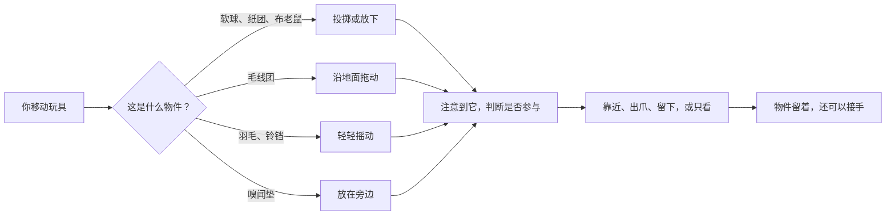
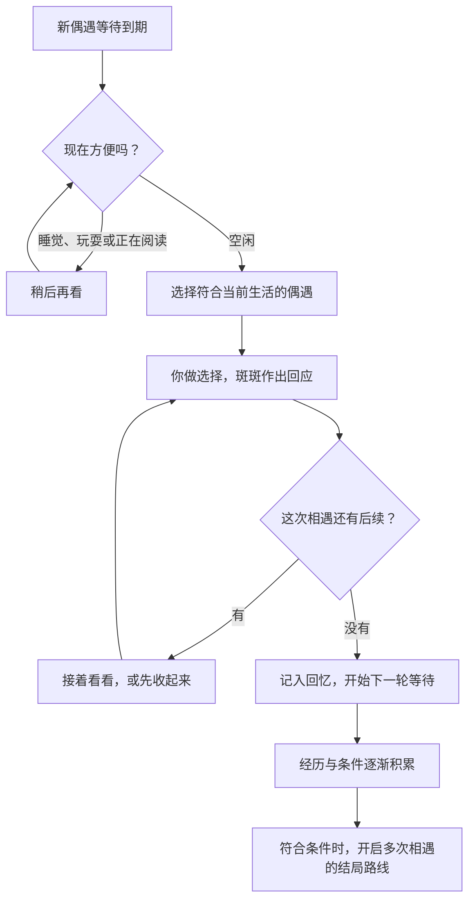

# 斑斑的小心思

[回到首页](../README.md) · [使用指南](USER-GUIDE.md) · [常见问题](FAQ.md)

斑斑的回应来自当前状态与动作规则：她困不困、刚刚发生了什么、和你熟不熟，以及眼前究竟是一颗球还是一团毛线。以下例子对应 **0.7.38** 的实际玩法，不是未来功能预告。

## 一天有松有紧

她会在散步、听动静、闻气味、理毛、伸懒腰和休息之间切换。短暂的兴奋可以是一小段奔跑，安静的时候也会有眨眼、耳朵和姿态上的变化。睡觉会占据一段完整时间，持续睡觉模式则由你决定什么时候结束。

亲密会影响被抱起、摸头和玩耍时的反应。她从初识、熟悉到亲密，需要日常陪伴积累；重复操作有间隔与每日上限，连续点按不会立刻换来一个完全驯服的回应。

## 例子一：同一颗球，四种心情

你把软球朝右轻轻丢出。球先运动、落地，斑斑再注意到它。她可能走近、扑一下，然后：

- **叼回来**：带着同一颗球回到你这边，放下后还可以再玩。
- **暂时占有**：把球留在爪边，自己研究。
- **拍走**：用爪子改变球的方向，看它继续滚。
- **只看或不理**：让球留在原处，继续自己的事。

熟悉程度会影响捡球意愿；疲倦、心情和最近连续玩耍的次数会影响是否参与。捡回来是一种可能，不是一项每次都要完成的任务。

## 例子二：挪一个睡着的小朋友

你想把睡着的斑斑移到屏幕另一边。

**慢慢拖动**时，她保持睡姿，放下后接着睡。**连续拖得快一些**时，她会先有被打扰的反应；如果你重新放慢，仍有机会安静下来。**突然快速一拽**则会让她醒来。

这里看的是移动速度和持续的扰动，不是「鼠标按住了多久」。重复打扰睡眠，她还会打哈欠、遮住眼睛，用泡泡表达想休息。你也可以直接右键「叫她起来」，不用靠拖拽把她弄醒。

## 例子三：一片叶子，从剧情变成玩具

「风推来的叶子」里，斑斑遇到的是**银杏叶**。她低下头，听见叶柄边的沙沙声。当前版本提供四个选择：

1. 🐾 轻按一下，再松开
2. 🌀 跟着叶子转一个小圈
3. 👃 闻闻叶面和叶柄
4. 😼 转头看看别处

选择「轻按一下，再松开」之后，结果是：

> 叶子在肉垫下停住。斑斑松开爪，等风把它推开一点，又歪着头看看它还动不动。

对应的小表演是先观察、轻轻碰触，再收回爪子。选择会影响这次经历，并被记进回忆。部分选择还能把同一片叶子交给你继续轻晃；不是每个剧情选择都会变成一件玩具。

如果你选择转头，回应也保留那一点猫的犹豫：头先转开，叶子再响时，耳朵又先回来了。

## 例子四：窗沿变了，她也要改主意

允许「爬前台窗口边」后，斑斑偶尔会找合适的窗口，靠近边缘、伸爪抓稳、交替向上，再探头看看。

她站的是某一个实际窗口的边。如果那个窗口移动、缩放、最小化或关闭，原来的落脚处就不再适合，她会结束这次动作并回到地面。系统暂时读不到合适窗口时，她会继续日常活动。

屏幕两侧还有短暂的攀爬变化：探头、换爪、看看周围，有时也会脚下一滑。返回地面使用轻巧的调整与落地动作，不将摔伤作为拖动或攀爬的奖励。

## 一段故事为什么不会马上跳到结局

桌宠有两种时间：**现实中的等待间隔**，以及**故事里的日期与时段**。30 分钟、1 小时、3 小时决定新偶遇多久可以出现；故事中的天气、时间、地点与过去经历，决定这次能遇见什么。

同一次相遇的续章可以接着看，整段经历不会因为多翻了几页就重复计入成长。通往结局的路线还要看是否真正遇过相关的人或地方，以及是否愿意继续这段关系。有些路线需要更多故事日数与后续经历。

结局出现时会单独展示。留下来继续生活，之后的日常会尊重这段住处与关系；选择新的漫游，才会打开另一轮可能。回忆册和你们的亲密会留下来。

## 目前的边界

- 窗口攀爬针对合适的前台应用窗口；跨屏、没有可用边缘等情况会被跳过，并非所有窗口与桌面图标都能攀爬。
- 结局内容有各自的前置条件。保留在内容库里，不代表每一条都能从当前日常直接触发；程序不会为了填满图鉴凭空制造危险。
- 泡泡和故事由预写内容与状态规则组织，不需要在线聊天服务，也不读取你正在写的文档来生成回应。

想了解具体操作，可回到 [使用指南](USER-GUIDE.md)。
